# Phase 2 — Architecture, structure & code-quality review

Evidence lives in three lane reports (file:line detail, route tables, density tables):
`_lane-worker.md` (W-001..W-016) · `_lane-frontend.md` (FE-001..FE-019) · `_lane-python-infra.md` (PY-001..PY-011).
Lane claims were produced by read-only subagents; I spot-checked the ones marked **[checked]**. Others are *reported, not independently re-derived* and carry that label until fixed with a test in Phase 7.

## 1. System as it actually is (Mermaid)

```mermaid
flowchart LR
  B[Browser SPA<br/>React/Vite, one 430 kB chunk] -->|/api same-origin| P[Pages Function proxy<br/>injects bootstrap ACCESS_CODE on POST /profile]
  P --> W[Worker hireflow-api<br/>hand-rolled route&#40;&#41;, Origin allowlist = CSRF defence]
  W --> D[(D1: 21 migrations, forward-only)]
  W --> K[(KV: private PDFs, exports, checkpoints)]
  W --> Q{{Queue hireflow-applications<br/>max_retries 100, concurrency 1, NO DLQ}}
  C[Cron] -->|enqueue maintenance only| Q
  Q --> W
  W --> BR[Browser Run<br/>owned QA form only]
  W --> AI[Workers AI BGE / Gemini / Groq]
  W --> SRC[Public job sources<br/>Lever/Greenhouse/Ashby/Internshala/...]
  W -.-> G[Gmail / Resend webhooks<br/>no verified delivery]
  subgraph Separate and unconnected
    PY[FastAPI + SQLAlchemy + Postgres<br/>local/container path, own records]
  end
  V[Vercel bridge: session transfer] -.-> W
```

No shared records between Worker and Python. Orchestration is Queue/outbox + D1 state — no agent graph.

## 2. Verdict by area
| Area | Assessment |
|---|---|
| AuthZ / tenancy | Strong. Every private Worker route has auth + ownership (mismatch → 404); FastAPI uses one global dependency enforcing session + ownership (src/api/main.py:18, security.py:110). **No IDOR found by static review** — Phase 3 must still attempt it dynamically. |
| Duplicate-submission invariant | Holds on Worker by design: conditional claim (tasks.ts:120), `submitting` checkpoint written before click (automation.ts:484), forward-only checkpoint upsert; eviction mid-submit → needs_action (W-008). Python: **PY-001 [checked] no UNIQUE(user_id, job_id) on `applications`** (Worker has it, 0001:31). |
| Queue reliability | Weak spot. **W-001 [checked]**: no dead-letter queue, `max_retries 100`, concurrency 1; one maintenance message runs ~12 recoveries serially and cron only enqueues — recovery depends on the queue it recovers. |
| Observability | W-002: unhandled errors → 503 without correlation id/error class. `/health` checks D1 only. |
| Data model | Worker schema sound (UNIQUE/CHECK present); JSON-in-TEXT mostly without `json_valid`; D1 forward-only with table rebuilds in 0020 and no tested rollback (W-006/W-007). Global `jobs` keyed by URL is writable by any user (W-003 [checked: url UNIQUE]) → first writer's content is reused. |
| Auth design | One shared ACCESS_CODE gates login/signup and derives checkpoint encryption key (W-004). Proxy injection (FE-001) is **intended** public-signup bootstrap; downgraded to S3 (intent undocumented; protection rests on signup rate limits — Phase 3 tests). |
| Headers / CSP | FE-002: none on Pages, Vercel or nginx (matches Phase 0 curl; no `_headers`). |
| Frontend resilience | FE-003/004/005: `useRemote.reload` clears data (tracker flashes every 10 s; plan selection resets every 2 s during preparing), no abort/401/retry, no error boundary. |
| Accessibility (static) | FE-010/011: 9 px badges at ~2.6–3:1 contrast, colour-only status, no route titles/focus management. No XSS sinks (no dangerouslySetInnerHTML; external hrefs scheme-filtered; rel set). |
| Python backend | PY-004/005: OpenAI/Anthropic clients lack timeouts; SSRF guard checks IP literals only and first fetch in scrapers is unguarded; swap/confirm return `str(e)` in 500s (PY-006). |
| Parity | Shared fixture exists only for listing pay facts (20 cases, read by both suites). Company normalization, scoring, status rules have none (PY-002). **Recommendation: Worker is the primary path; keep Python as a documented local/reference module (decision D-7), no new Python features.** |
| CI/Docker | Dockerfile good (non-root, healthcheck, layers). CI: no `permissions:`, no pins, no Dependabot/CodeQL (PY-003 = F-004). |
| Docs | PY-008: five conflicting test-count claims across 8+ files; plan a single "Status & evidence" doc, mark historical docs. |
| Readability | W-016: 256 lines >300 chars in Worker src, max 1,321 (intelligence.ts). Formatting fixes most; SQL/prompt strings need manual extraction. Worst: workspace_backup(26), email_delivery(24), discovery_cycles(21), prep_intelligence(17), hiring(16). God files + 130-line `processTask`; plans↔plan_tasks import cycle; ~15 dead exports. |

## 3. Severity roll-up (lane findings; no S0 in any lane)
- **S1:** PY-001 (Python duplicate application rows possible; Python path only).
- **S2:** W-001, W-002, W-003, W-004, W-016, FE-002, FE-003, FE-004, FE-005, FE-010, FE-011.
- **S3/S4:** remainder (see lane files). FE-001 re-rated S3.
Not yet examined (open risk): discovery_tasks / discovery_cycles / plans handlers' uid scoping (W lane read partially); `report_generator.py` and several scripts (PY lane). Phase 3 dynamic IDOR sweep covers these.

## 4. Decisions / recommendations carried forward
1. Add a DLQ (or bounded retries + failure sink) and split maintenance into per-task messages (W-001) — test-first in Phase 7.
2. Add `UNIQUE(user_id, job_id)` Alembic migration for Python (PY-001) with a failing test first.
3. Preserve data on poll (`useRemote` stale-while-revalidate), add error boundary, 401 handling, route titles/focus (FE-003..005, 011).
4. `_headers` with CSP/HSTS/frame-ancestors/nosniff/Referrer-Policy/Permissions-Policy (F-006/FE-002) — verify no break via E2E.
5. Document D-7: Worker primary; Python frozen/reference.
6. Tooling baseline (Prettier/ESLint/ruff/editorconfig, isolated format commit) precedes all other fixes (Phase 7 step 1).
