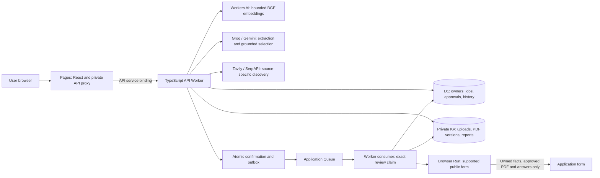
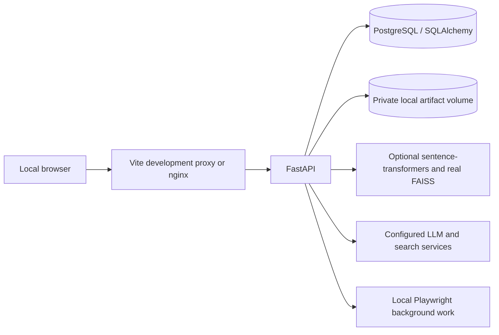

# HireFlow architecture

The live application is [Cloudflare Pages](https://hireflow-dashboard.pages.dev/profile)
plus the [HireFlow API Worker](https://hireflow-api.baidpankaj567.workers.dev/health).
The repository also maintains an independent Python/FastAPI application for local
or container use. They share product concepts and much of the HTTP shape, but
**do not share database records or all execution guarantees**.

## Deployed request and work flow

The Worker is an ordinary TypeScript application with explicit functional
boundaries. It is not a LangGraph `StateGraph`, a Python process or a FAISS server.
Queue/outbox state and browser checkpoints provide the real orchestration.

| Boundary | Source and responsibility |
| --- | --- |
| API/authentication | `cloudflare/src/index.ts`, `auth.ts`, `account_security.ts`: matched routes, ownership cookie, passkey assertions, one-use keys and session revocation. |
| Intake/profile | `profile.ts`, `intelligence.ts`: bounded PDF extraction, validated facts/preferences and profile versions. |
| Discovery/listing evidence | `intelligence.ts`, `listing_details.ts`: mode-specific fan-out, canonical URLs, active full JDs, structured compensation/experience and evidence-labelled quality rules. |
| Ranking/plan | `plans.ts`, `semantic_matching.ts`, `company_policy.ts`: six-factor lexical/hybrid ranking, private versioned embeddings, quota, prior-employer exclusion and plan selection. |
| Draft/review | `resume_tailoring.ts`, `pdf.ts`, `reviews.ts`, `review_contract.ts`: copied facts, readable PDFs, immutable edits/versions, exact answer/PDF approval and atomic queued cancellation. |
| Execution | `tasks.ts`, `automation.ts`, `automation_checkpoints.ts`: review-bound claims, budget/spacing, native supported steps, encrypted recovery and no blind repeat after uncertain writes. |
| Preparation/report | `intelligence.ts`, `reports.ts`: JD-based study material, source-backed/unknown company evidence and private weekly HTML. |
| Operations/storage | `telemetry.ts`, `provider_health.ts`, `storage.ts`, `files.ts`: redacted events, readiness/alerts, transactional persistence and private artifact adapters. |

## Lifecycle and authorization

1. A new profile receives its own HttpOnly host-only session. Normal signup asks
   for no operator code or numeric profile credential. The Pages proxy holds the
   server bootstrap secret; the browser never receives it. Private requests check
   the session owner, not an ID supplied from browser storage.
2. Resume extraction preserves source facts. Users edit structured experience,
   projects, education and preferences before searching. The saved profile
   version participates in draft, embedding and approval freshness.
3. Discovery performs five source searches in Internship mode or four in Job
   mode. It verifies bounded public full-JD candidates and exposes restricted,
   unavailable and empty sources. It is not an authenticated feed or a 100+
   listing background cycle.
4. The plan uses the documented six-factor score. Genuine BGE embeddings can
   blend only 20% of the existing technical factor; explicit skill gaps remain
   exact. The model/source/profile cache is private and bounded. The
   [evaluation](ai-evaluation.md) explains the measured synthetic improvement.
5. The user opens **Review resume & answers**, can edit/compare/reject/regenerate,
   and approves one immutable PDF/profile/JD/answer binding. Confirmation records
   that review generation atomically with an outbox message. A provider retry,
   plan refresh or new PDF alone never authorizes application.
6. The queue consumer claims that exact generation against cancellation and
   validates the PDF hash and current review before advancing/submitting. A stale
   message cannot execute or mark a newer approval delivered. Form filling uses
   the immutable reviewed profile snapshot, not a newly generated answer.
7. The tracker records `planned`, `confirmed`, `applying`, `applied`, `failed` or
   `needs_action`, with timestamp/reason and manual destination where relevant.
   An uncertain external operation retains its no-repeat marker. Cancelling
   queued work cannot withdraw an application already accepted by an employer.
8. Reports and PDF versions remain private. Preparation estimates are labelled;
   missing source evidence stays unknown. Report creation does not send email.

An applied employer is excluded from future automatic plans according to the
explicit company policy, including configured aliases. Failed pre-submission
attempts are not treated as applications; unresolved potential external writes
are handled conservatively. Employer identity normalization does not equate
arbitrary similarly named companies.

## Infrastructure and limits

D1 stores metadata, authorization and status history. Private Workers KV stores
PDFs/uploads/reports; R2 is an optional adapter and has not been activated as a
paid requirement. No artifact is published as an unauthenticated storage URL.
Pages forwards `/api` through a fixed service binding rather than an arbitrary
caller-supplied origin. The old Vercel host is only a temporary source-cookie
migration bridge.

The five-minute cron repairs outbox/recoverable work and prunes selected private
operational state. It is **not a complete weekly scheduler**. Browser attempts
reserve 60 seconds against a maximum 540-second daily account gate; launch
spacing is at least 21 seconds. Displayed weekly quota is not a promise of that
many successful automatic applications per day. Embeddings have an independent
atomic 100-text/day application cap. Provider limits/failures produce safe
fallback or manual action, never a fabricated success.

[Operations evidence](p0-operations.md) records measured wall/CPU/memory separately.
A small smoke run cannot certify sustained free-tier capacity. No paid resource
or plan is enabled automatically.

## Independent Python/container runtime

Python uses Alembic migrations, local storage and a distinct owner/session table.
It now enforces cookie ownership and supports single-use recovery keys; it
explicitly reports passkeys unavailable. With the optional embedding dependencies
and `SEMANTIC_MATCHING_ENABLED=true`, its normal scorer invokes the real FAISS
pipeline with owner/model/source-versioned private caches. Its configurable model
is separate from the deployed Worker's BGE configuration.

Python still has a separate confirmation/form implementation. Cloudflare's exact
immutable answer-review contract and encrypted multi-step recovery must not be
implied for Python until the backend-parity work is complete. FastAPI background
tasks are not the Cloudflare Queue or a durable cluster scheduler. A local API
process interrupted during an external submission requires manual reconciliation.

## Security, AI and verification boundaries

- Contact email is not verified identity. Passkeys/keys must be saved while an
  owner still has access. Email/profile numbers alone never recover a workspace.
- Embedding requests intentionally omit contact/identity fields. External JDs
  are task data; they do not grant permission to expose a profile or alter the
  authorized submission. There is no applying-time free-text LLM answer call.
- CAPTCHA/login/custom widgets and unsupported multi-step state require manual
  action. Public ATS-shaped fixtures are not vendor certification or evidence
  of a submitted real employer application.
- Default tests use isolated data and controlled forms. Opt-in provider/production
  probes use synthetic sources and the owned QA form. No real email delivery is
  claimed; verified sender/provider setup remains separate.
- The synthetic AI benchmark has frozen labels/thresholds and genuine model
  vectors, but no independent human ratings or hiring-outcome validation.

Start with [fresh setup](fresh-setup.md), [workflow](workflow.md),
[deployment](cloudflare.md), [account recovery](account-security.md),
[portal compatibility](portal-compatibility.md) and [the audit](milestone-audit.md).
The [demo](demo.md) describes the reviewable, bounded product path.
